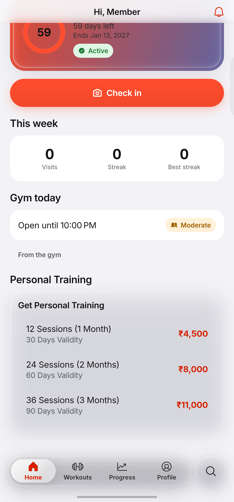
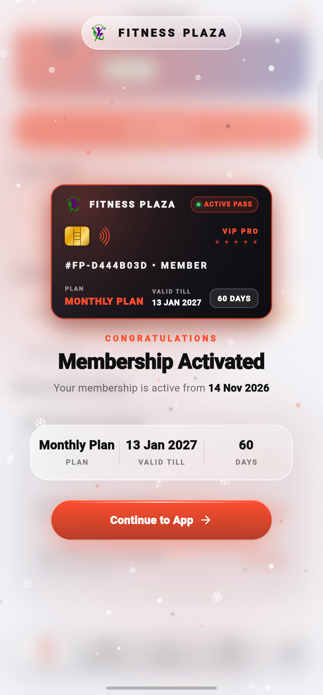
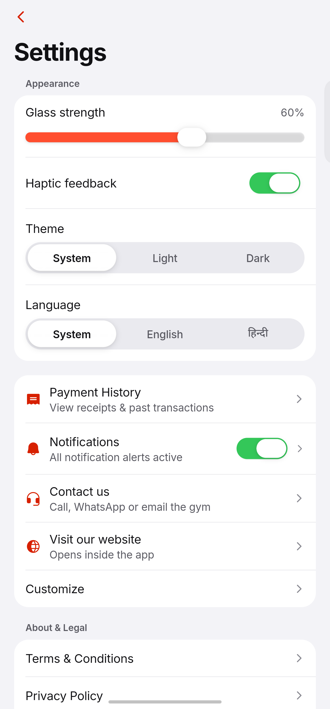

# Fitness Plaza - Gym Member App

Fitness Plaza is a production-grade, full-stack gym management ecosystem built for modern fitness clubs. It features a native Flutter Member App backed by Supabase PostgreSQL with Row Level Security, automated WhatsApp OTP & push alerts, bilingual English & Hindi support, and a fluid 144Hz Liquid Glass design system.

---

## Member App Screenshots

| Home Dashboard | Membership Activated | Settings |
| :---: | :---: | :---: |
|  |  |  |

---

## Member App Download (Release v1.0.0+8012)

Official production Member App binaries for Android and iOS (R8 minified & Dart symbol-obfuscated):

| Platform | Package | Architecture | Size | Target Devices | Download |
| :--- | :--- | :--- | :--- | :--- | :--- |
| **Android** | Split APK (64-bit) | `arm64-v8a` | 33.8 MB | 99% of modern Android phones (Xiaomi, Samsung, OnePlus, Vivo, Oppo, Realme, iQOO, Pixel) | [Download](https://github.com/anuraaag23/fitness-plaza/releases/download/v1.0.0%2B8012/Fitness_Plaza_Member_App_v1.0.0_arm64-v8a_release.apk) |
| **Android** | Split APK (32-bit) | `armeabi-v7a` | 30.3 MB | Older & budget 32-bit phones (Redmi 9A/A1/A2, Samsung A03 Core, Android Go devices) | [Download](https://github.com/anuraaag23/fitness-plaza/releases/download/v1.0.0%2B8012/Fitness_Plaza_Member_App_v1.0.0_armeabi-v7a_release.apk) |
| **Android** | Split APK (Chromebook / x86) | `x86_64` | 36.2 MB | Chromebooks, Intel / AMD Android tablets, and desktop emulators | [Download](https://github.com/anuraaag23/fitness-plaza/releases/download/v1.0.0%2B8012/Fitness_Plaza_Member_App_v1.0.0_x86_64_release.apk) |
| **Android** | Universal APK | All ABIs | 87.5 MB | All-in-one package compatible with every Android device | [Download](https://github.com/anuraaag23/fitness-plaza/releases/download/v1.0.0%2B8012/Fitness_Plaza_Member_App_v1.0.0_Universal_release.apk) |
| **Apple iOS** | Native IPA | `arm64` (iOS 16+) | 32.1 MB | iPhone and iPad (Install via Sideloadly, AltStore, Scarlet, TrollStore) | [Download](https://github.com/anuraaag23/fitness-plaza/releases/download/v1.0.0%2B8012/Fitness_Plaza_Member_App_v1.0.0_iOS.ipa) |

### Installation Instructions

- **Android**: Download the APK matching your device architecture (recommended: **64-bit `arm64-v8a`**, or **Universal** if unsure), open the file, and tap **Install** (enable *Install Unknown Apps* if prompted).
- **iOS (iPhone/iPad)**:
  1. Download the `.ipa` package above on PC or iPhone.
  2. Sideload using **Sideloadly** (Windows/Mac), **AltStore**, or your preferred installer with your Apple ID.
  3. On your iPhone, open **Settings > General > VPN & Device Management**, tap your Apple ID under Developer App, and tap **Trust**.

---

## Member App Features

- **WhatsApp OTP Login**: One-tap mobile sign-in with instant server-verified WhatsApp OTP.
- **Live Membership Card & Gym Status**: Real-time membership pass showing plan validity, days remaining, live gym operating hours, and live crowd level.
- **Daily QR Attendance Check-In**: Scan the gym counter QR with automatic single check-in per day validation, streak tracking, and monthly attendance calendar.
- **896+ Exercise Library & Workout Tracker**: Start/finish visual form demonstrations, step-by-step instructions, muscle/equipment filters, custom routines, rest timer, body weight goals, and personal records (PRs).
- **Diet Plans & Personal Training**: View trainer-assigned and personal diet plans, browse PT packages, and pay via UPI or Pay Cash at Desk.
- **Live Step Counter**: Built-in hardware pedometer plus Samsung Health / Health Connect integration with 7-day history and calorie/distance estimates.
- **Real-Time Push Notifications**: Instant alerts for gym notices, broadcasts, diet plans, membership freeze updates, and payment receipts — even when the app is closed.
- **Bilingual Support (English & Hindi)**: Complete localization across all screens, alerts, and legal policies.
- **Self-Service Membership Freeze & Account Deletion**: Request membership freezes within gym policy limits and manage data privacy under DPDP Act 2023.

---

## Security & Hardening

- **Binary & Reverse-Engineering Protection**: Release builds are compiled with Android R8 code shrinking/obfuscation, resource shrinking, debug log stripping, and Dart AOT symbol obfuscation (`--obfuscate --split-debug-info`).
- **Transport & Storage Hardening**: Global cleartext HTTP disabled (`usesCleartextTraffic="false"`), Android backup extraction blocked (`allowBackup="false"`), and sensitive credentials excluded from version control.
- **Server-Side Authorization**: Backend access is enforced via PostgreSQL Row Level Security (RLS), `SECURITY DEFINER` RPCs, and cryptographically generated session tokens.
- **DPDP Act 2023 Compliance**: In-app privacy policy, refund policy, gym rules, and account deletion workflow.

---

## Proprietary Notice & Copyright

All rights reserved. This software, its source code, architecture, designs, liquid glass shaders, and branding are proprietary and confidential to Fitness Plaza.

Unauthorized copying, cloning, reverse engineering, redistribution, or reproduction of this codebase or its assets, via any medium or platform, is strictly prohibited without explicit written authorization.

Copyright 2026 Fitness Plaza. All rights reserved.
